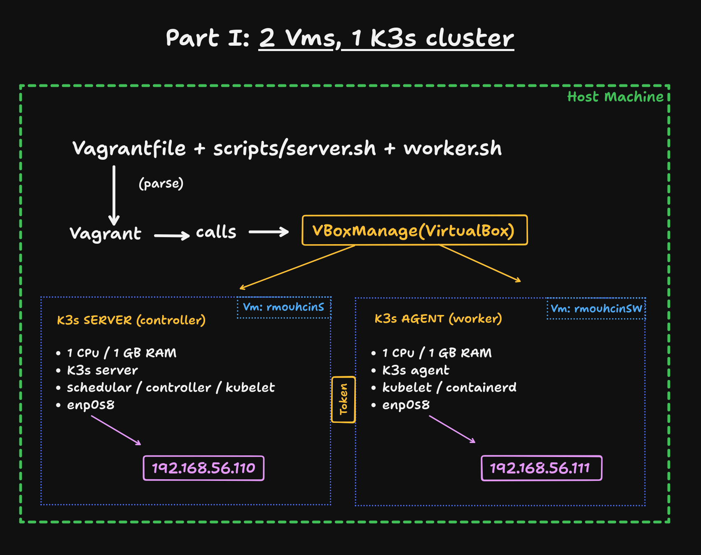
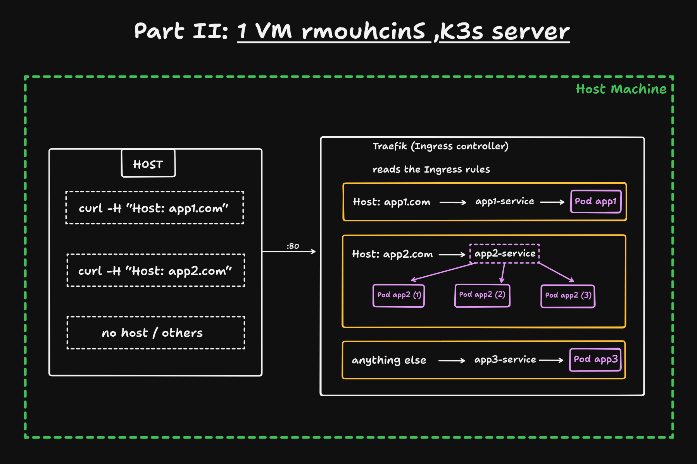
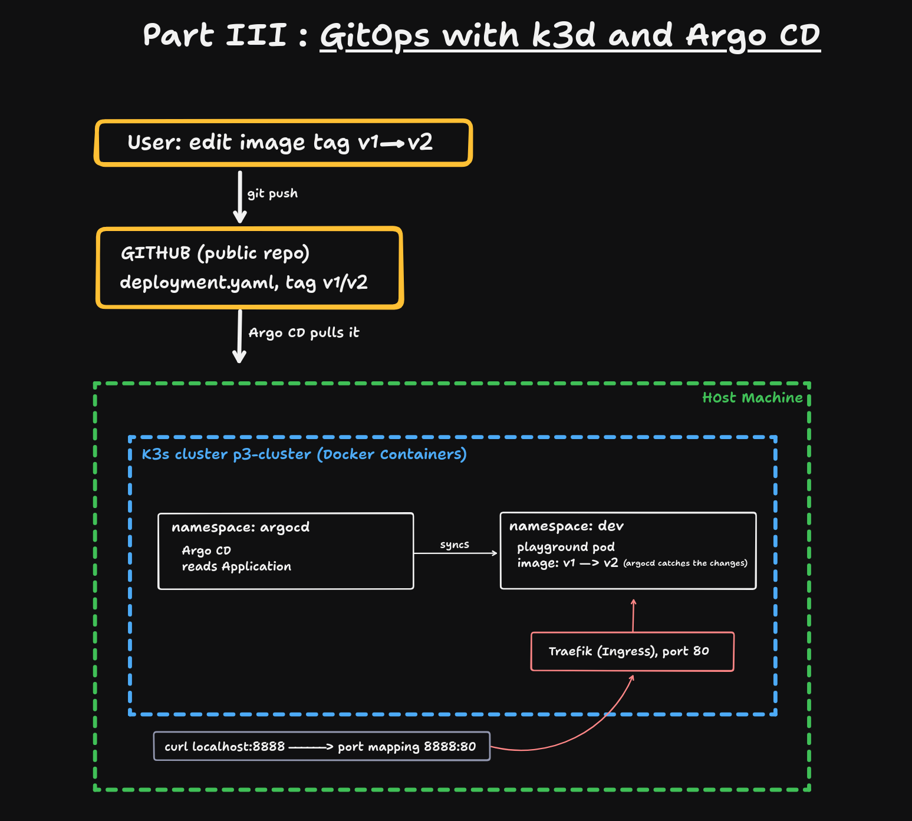

# Inception-of-Things

Introduction to Kubernetes with K3s, K3d and Argo CD.

## Part 1: K3s and Vagrant

Two virtual machines are created by Vagrant on VirtualBox. The first runs a K3s
server, the second runs a K3s agent that joins it, forming a single cluster.



### How it works

1. Vagrant reads the `Vagrantfile` and calls VirtualBox (`VBoxManage`) to create the two VMs.
2. `scripts/server.sh` installs K3s in server mode on `rmouhcinS` (`192.168.56.110`).
3. The server writes its node token to the shared `/vagrant` folder.
4. `scripts/agent.sh` waits for the token, then installs K3s in agent mode on
   `rmouhcinSW` (`192.168.56.111`) and joins the server on port 6443.
5. Both VMs talk to each other over the private network `192.168.56.0/24`
   (interface `enp0s8`). K3s is forced to use it with `--node-ip` and `--flannel-iface`.

### Usage

```bash
cd p1
vagrant up
vagrant ssh rmouhcinS
kubectl get nodes -o wide
```

Expected result: two nodes in `Ready` state, with `192.168.56.110` and
`192.168.56.111` as INTERNAL-IP.

## Part 2: K3s and three simple applications

One VM, `rmouhcinS`, runs a K3s server with three web applications. An Ingress
(Traefik) routes each request by hostname to the right application.



### How it works

1. Vagrant creates one VM, `rmouhcinS` (`192.168.56.110`), and `scripts/server.sh`
   installs K3s in server mode.
2. The manifests in `configurations/` deploy three applications: app1 (1 replica),
   app2 (3 replicas) and app3 (1 replica).
3. Traefik listens on port 80 and reads the Ingress rules.
4. The `Host` header of each request selects the application:
   - `app1.com` goes to app1
   - `app2.com` goes to app2
   - any other host goes to app3 (default)

### Usage

```bash
cd p2
vagrant up
curl -H "Host: app1.com" 192.168.56.110
curl -H "Host: app2.com" 192.168.56.110
curl 192.168.56.110
```

Expected result: each request is answered by the matching application, and app3
answers when no host matches.

## Part 3: K3d and Argo CD

A K3s cluster runs inside Docker containers (K3d). Argo CD watches a public GitHub
repository and deploys its content automatically. Changing the image tag in Git
updates the running application with no manual `kubectl`.



### How it works

1. `scripts/requirements.sh` installs Docker, `kubectl` and K3d.
2. `scripts/setup.sh` creates the K3d cluster (host port 8888 mapped to Traefik's
   port 80), the namespaces `argocd` and `dev`, and installs Argo CD.
3. `confs/application.yaml` tells Argo CD to watch the GitHub repository and deploy
   it in the `dev` namespace, with automated sync.
4. The repository holds the application manifests with the image `wil42/playground:v1`.
5. Changing the tag to `v2` and pushing makes Argo CD replace the pod
   (it checks Git about every three minutes).

### Usage

```bash
cd p3
./scripts/requirements.sh
./scripts/setup.sh
kubectl apply -f confs/application.yaml
curl http://localhost:8888/
```

Expected result: `{"status":"ok", "message": "v1"}`. After switching the tag to
`v2` in the repository and pushing, the same command answers `"message": "v2"`.

---

Made by Rachid Mouhcine (`rmouhcin`)