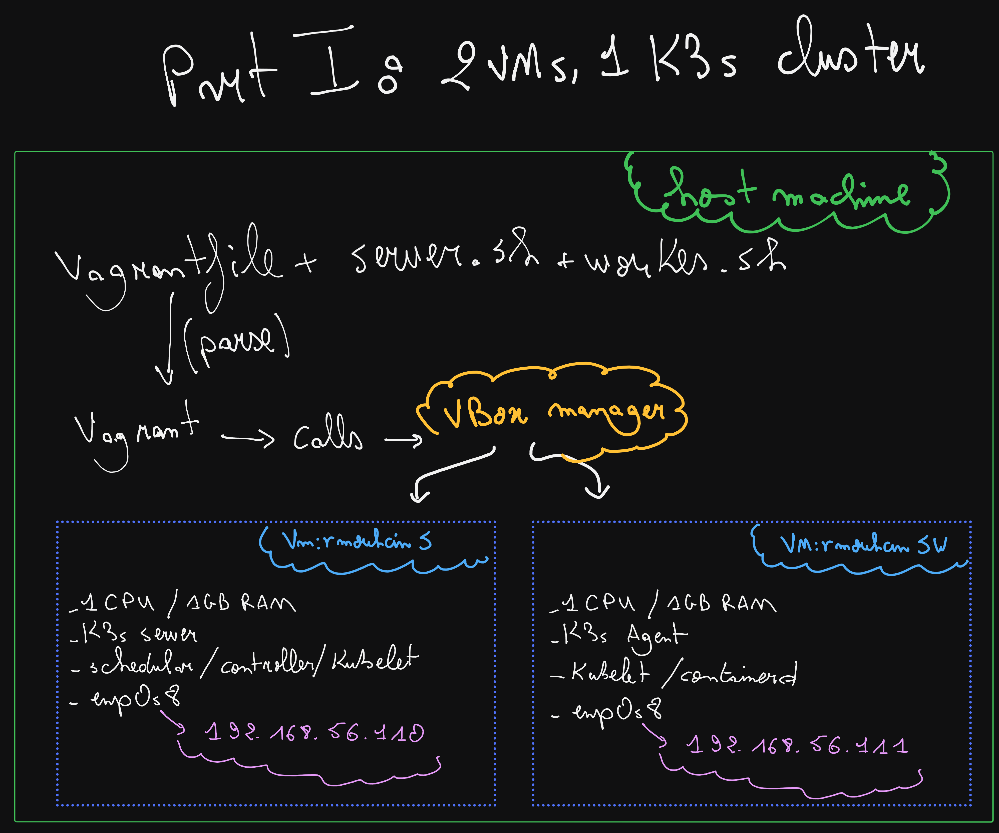

## Part 1: K3s and Vagrant

Two virtual machines are created by Vagrant on VirtualBox. The first runs a K3s
server, the second runs a K3s agent that joins it, forming a single cluster.



### How it works

1. Vagrant reads the `Vagrantfile` and calls VirtualBox (`VBoxManage`) to create the two VMs.
2. `scripts/server.sh` installs K3s in server mode on `rmouhcinS` (`192.168.56.110`).
3. The server writes its node token to the shared `/vagrant` folder.
4. `scripts/agent.sh` waits for the token, then installs K3s in agent mode on
   `rmouhcinSW` (`192.168.56.111`) and joins the server on port 6443.
5. Both VMs talk to each other over the private network `192.168.56.0/24`
   (interface `enp0s8`). K3s is forced to use it with `--node-ip` and `--flannel-iface`.

### Usage

```bash
cd p1
vagrant up
vagrant ssh rmouhcinS
kubectl get nodes -o wide
```

Expected result: two nodes in `Ready` state, with `192.168.56.110` and
`192.168.56.111` as INTERNAL-IP.

Made by Rachid Mouhcine (`rmouhcin`)